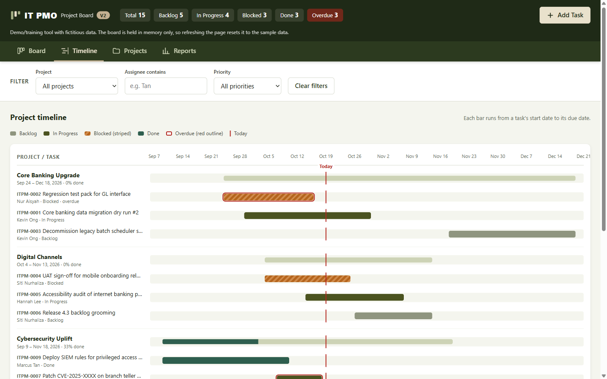
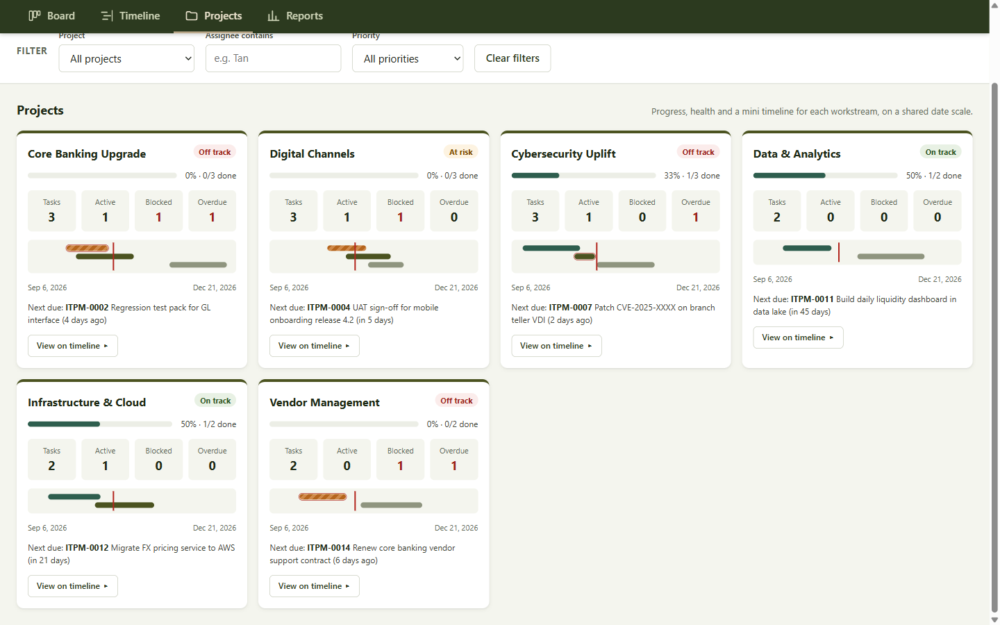
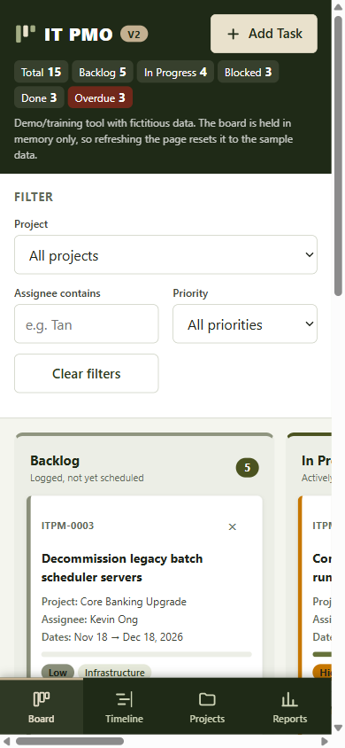

# kanban7-v2 — IT PMO Kanban (v2)

Version 2 of a single-file Kanban board for the IT PMO of a fictitious bank: an army-green redesign with project timelines, four tabbed views, a mobile layout and a hardened security posture. Built in vanilla HTML, CSS and JavaScript.

[](https://github.com/alfredang/kanban7-v2/actions/workflows/pages.yml)


[](https://alfredang.github.io/kanban7-v2/)

**Live demo:** https://alfredang.github.io/kanban7-v2/
**Version 1 (unchanged):** https://alfredang.github.io/kanban7/


> **Sample data only.** Every task, project, person and ID on the board is made up. "IT PMO" is a neutral wordmark, not a real bank's brand.

## What's new in v2

| Area | Change |
| --- | --- |
| **Theme** | Army-green palette (`--army: #4b5320`, olive, khaki and sand tokens on `:root`). |
| **Tabs** | Four views: **Board**, **Timeline**, **Projects**, **Reports**. They follow the WAI-ARIA tabs pattern (arrow keys, Home/End) and deep-link via `#board`, `#timeline`, `#projects` and `#reports`, so the browser Back button works. |
| **Timelines** | A Gantt chart grouped by project, with a project roll-up bar showing % done, weekly ticks and a Today line. Each project card has its own mini timeline on a shared date scale. Tasks now have a **start date** as well as a due date. |
| **Mobile** | Bottom tab bar with safe-area insets, swipeable board columns, stacked Gantt rows, a full-screen Add Task sheet, 44 px touch targets and 16 px inputs so iOS doesn't zoom. |
| **Security** | Hash-based Content-Security-Policy, input sanitising, a honeypot, rate limiting, hardened `fetch`, and a frame-busting guard. See [Security](#security). |

| Timeline | Projects | Mobile |
| --- | --- | --- |
|  |  |  |

## Features

- **Board**: four columns (Backlog, In Progress, Blocked, Done). Move cards by drag-and-drop or with the keyboard-accessible **Move ▸** menu. Delete with an inline "Delete? Yes / No" confirmation.
- **Timeline**: each task is a bar from its start date to its due date, coloured by status. Blocked bars are striped and overdue bars have a red outline, so colour isn't the only signal.
- **Projects**: one card per workstream with a health badge (On track / At risk / Off track / Complete), % complete, task / active / blocked / overdue counts, a mini timeline and the next due task. **View on timeline ▸** jumps to that project's Gantt.
- **Reports**: status mix, tasks by priority, open tasks per assignee, and an overdue table.
- **Filters** by project, assignee (substring) and priority apply to every tab.
- **Add Task** form with inline validation. IDs are generated as `ITPM-####`.
- Optional email notification for each new task through [FormSubmit](https://formsubmit.co).

**Nothing is saved.** The board lives in memory, so refreshing the page resets it to the sample data. This is deliberate. Sample dates are relative to today, so some tasks are always overdue.

## Security

The app is a static page with no backend. The hardening focuses on what a static page can control:

| Threat | Control |
| --- | --- |
| XSS / injected markup | A strict **Content-Security-Policy** (`default-src 'none'`). The inline `<style>` and `<script>` are allowed only by their **SHA-256 hashes**, with no `'unsafe-inline'` or `'unsafe-eval'`, so injected `<script>`, `onerror=` handlers and `style=` attributes are all blocked. Every user string still goes through `escapeHtml()`. |
| Data exfiltration | `connect-src` allows only `https://formsubmit.co`. `img-src` allows only `data:`. `base-uri`, `form-action` and `object-src` are `'none'`. |
| Spoofed or hidden text | `cleanText()` strips control characters and bidi-override / zero-width characters, which also prevents email-header injection. Assignee names allow only letters, spaces, `.`, `'` and `-`. Dates are checked against the calendar and a sane range. |
| Inbox spam / abuse | A honeypot field, a client-side rate limit (5 emails a minute) and a 10-second request timeout. While the address is the placeholder, **no request is sent at all**. |
| Request hardening | `fetch` uses `credentials: "omit"`, `redirect: "error"`, `cache: "no-store"` and `referrerPolicy: "strict-origin"`. Only an `https://formsubmit.co/ajax/…` endpoint is accepted. |
| Clickjacking | The app refuses to render inside a frame. A meta CSP can't set `frame-ancestors`, and GitHub Pages can't send custom headers. |
| Drag-and-drop spoofing | Drops are accepted only for strings matching the `ITPM-####` ID pattern. |
| Supply chain | No dependencies, CDNs, fonts or external scripts. CI fails the build if any appear. |
| Secrets | gitleaks runs on every push and pull request. |

See [SECURITY.md](SECURITY.md) for how to report a problem.

## Installation

There is no build step, package manager or dependencies. Clone the repository:

```bash
git clone https://github.com/alfredang/kanban7-v2.git
cd kanban7-v2
```

## Running locally

Open `index.html` in a browser:

| OS | Command |
| --- | --- |
| Windows (PowerShell) | `Start-Process index.html` |
| macOS | `open index.html` |
| Linux | `xdg-open index.html` |

To test real email delivery, set your address (see below), then serve the folder over http, because FormSubmit rejects `file://` pages:

```
python -m http.server 8000
```

Then open http://localhost:8000.

## Configuration

All settings are at the top of the `<script>` block in `index.html`:

| Constant | Purpose |
| --- | --- |
| `FORMSUBMIT_ENDPOINT` | Where new-task emails go. **Replace `YOUR_EMAIL@example.com`** with a real address. Until you do, email is switched off and nothing leaves the browser. |
| `ID_PREFIX` | Task ID prefix (`ITPM`). |
| `SUBJECT_PREFIX` | Email subject prefix (`[IT PMO]`). |
| `NOTIFY_RATE`, `NOTIFY_TIMEOUT_MS` | Email rate limit and request timeout. |

FormSubmit needs a one-time activation. The **first** submission to a new address is not delivered. Instead, FormSubmit emails a confirmation link to that address, and later submissions arrive only after someone clicks it.

Projects, categories, priorities and statuses come from the `PROJECTS`, `CATEGORIES`, `PRIORITIES` and `STATUSES` arrays, which drive both the dropdowns and validation.

### After editing the style or script: refresh the CSP hashes

The CSP allows the inline `<style>` and `<script>` by hash, so **any edit to either block needs new hashes**, or the browser blocks it:

```bash
node tools/csp.mjs --write   # update the hashes in index.html
node tools/csp.mjs --check   # verify (CI runs this)
```

`.gitattributes` forces LF line endings so the hashes match on every platform.

## CI/CD

[.github/workflows/pages.yml](.github/workflows/pages.yml) runs two jobs:

1. **Checks** run on every push and pull request to `main`:
   - a secret scan with [gitleaks](https://github.com/gitleaks/gitleaks)
   - HTML validation with [html-validate](https://html-validate.org) (rules in [.htmlvalidate.json](.htmlvalidate.json))
   - a CSP hash check (`node tools/csp.mjs --check`)
   - a project-rules check that fails on a missing CSP, `unsafe-inline` / `unsafe-eval`, inline `style=` or `on…=` attributes, `eval` / `new Function`, `localStorage`, `sessionStorage`, IndexedDB, cookies, `alert()`, `confirm()`, `!important`, or external scripts and stylesheets
2. **Deploy** runs on pushes to `main`, and only if the checks pass. It publishes only `index.html` to GitHub Pages, so repo files such as `CLAUDE.md` are not served.

## Project structure

```
index.html                  The whole app: markup, <style> and <script>
tools/csp.mjs               Recomputes / checks the CSP hashes (Node, no dependencies)
docs/screenshot*.png        Screenshots used in this README
.github/workflows/pages.yml CI checks and GitHub Pages deploy
.htmlvalidate.json          HTML validation rules
.gitattributes              Forces LF so CSP hashes are stable
SECURITY.md                 Security policy
CLAUDE.md                   Architecture notes and constraints
```

## Contributing: conventions to keep

- Vanilla HTML/CSS/JS only: no frameworks, libraries, CDNs, web fonts or image assets. Icons are inline SVG.
- No persistence: no `localStorage`, `sessionStorage`, IndexedDB or cookies.
- No `alert()` or `confirm()`. Errors appear inline, and delete uses the inline confirm row.
- No `!important`, and no inline `style=` attributes. Position bars with `data-left` / `data-width`, which `applyGeometry()` applies via CSSOM.
- Run every user-supplied string through `escapeHtml()` before it goes into an HTML template.
- State flows one way: actions update `state`, then call `render()`.
- Run `node tools/csp.mjs --write` after changing the `<style>` or `<script>`.
- Keep neutral branding. Never use a real bank's name, logo or trademarks.

## Testing

There is no automated test suite. Test manually in a browser at desktop and phone widths: add, move, filter and delete tasks; switch tabs with the mouse, the arrow keys and the Back button; check the inline validation messages; and confirm the console shows no CSP violations.
